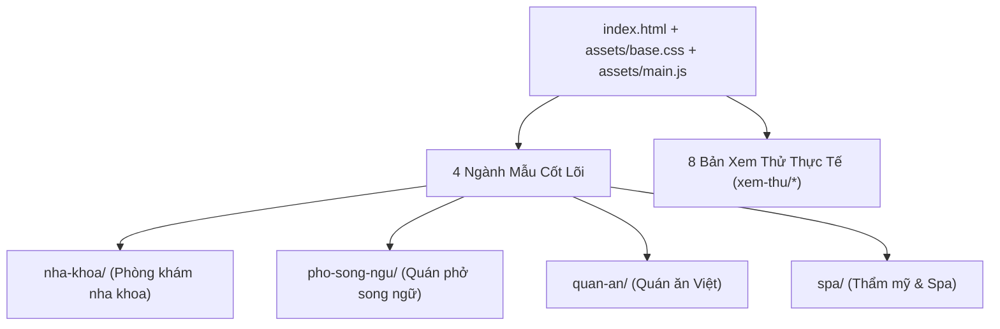

# web-cho-tiem

[](./LICENSE)
[](https://developer.mozilla.org/en-US/docs/Web/HTML)
[](https://developer.mozilla.org/en-US/docs/Web/CSS)
[](https://developer.mozilla.org/en-US/docs/Web/JavaScript)

Bộ landing page tĩnh tốc độ cao dành cho tiệm, phòng khám nha khoa, spa và quán ăn/nhà hàng Việt — không cần build step, tối ưu mở trực tiếp trên GitHub Pages hoặc bất kỳ static host nào.

## Kiến trúc & Bộ mẫu có sẵn



## Cấu trúc thư mục

```text
web-cho-tiem/
├── index.html                  # Trang giới thiệu & điều hướng mẫu
├── .nojekyll                   # Tắt Jekyll khi deploy GitHub Pages
├── assets/
│   ├── base.css                # Hệ thống kiểu chữ, màu sắc và layout dùng chung
│   └── main.js                 # Tương tác DOM & điều hướng thuần Vanilla JS
├── nha-khoa/index.html         # Mẫu website phòng khám nha khoa
├── pho-song-ngu/index.html     # Mẫu website quán phở song ngữ Việt - Anh
├── quan-an/index.html          # Mẫu website quán ăn gia truyền
├── spa/index.html              # Mẫu website spa & chăm sóc sắc đẹp
└── xem-thu/                    # 8 bản preview cho từng tiệm cụ thể
    ├── angel-tay-thi/
    ├── bar-pho-76/
    ├── bbq-garden/
    ├── con-ga-mai/
    ├── duc-anh-quan/
    ├── letty-beauty/
    ├── nha-khoa-minh-tam/
    └── nha-khoa-tri-huy/
```

## Chạy cục bộ (Quick Start)

Do toàn bộ là HTML/CSS/JS thuần, bạn có thể mở trực tiếp `index.html` hoặc phục vụ bằng server tĩnh bất kỳ:

```bash
git clone https://github.com/tranhoangtu-it/web-cho-tiem.git
cd web-cho-tiem
python -m http.server 8080
```

Truy cập `http://localhost:8080` để xem cổng mẫu và tất cả 8 trang trong `xem-thu/`.

## Giấy phép

Phát hành theo [MIT License](./LICENSE).
